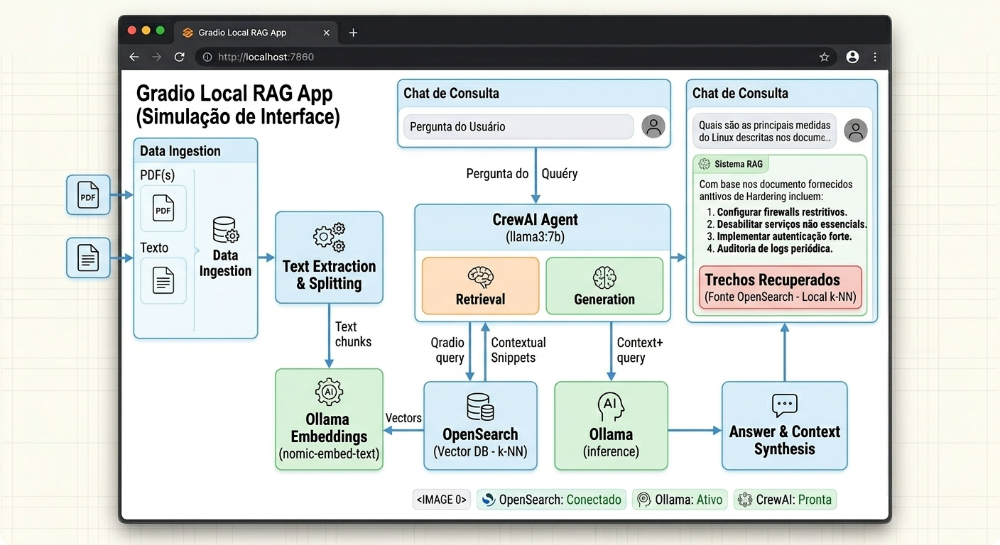
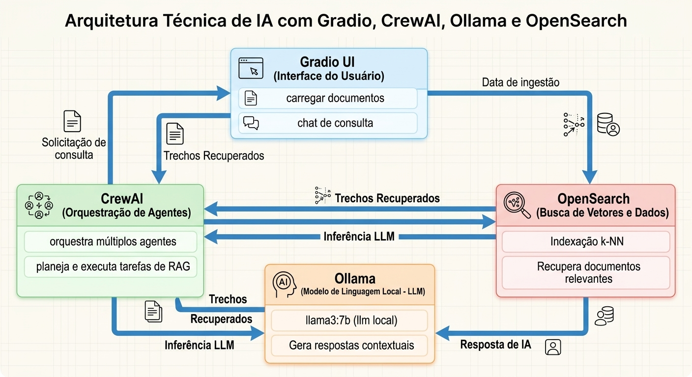

# Prot_lumerag — RAG local com CrewAI, OpenSearch e Ollama


Aplicação experimental de geração aumentada por recuperação (RAG) que permite
carregar documentos, recuperar trechos relevantes e consultar seu conteúdo em
português. A inferência e a geração de embeddings usam modelos locais servidos
pelo Ollama; o OpenSearch armazena os vetores, e um agente CrewAI prepara a
resposta com base nos trechos recuperados.

> **Status:** protótipo de aprendizado, não pronto para produção. A recuperação
> vetorial pode retornar trechos irrelevantes, e o modelo pode errar ou afirmar
> algo que as fontes não sustentam. Confira sempre os trechos exibidos junto à
> resposta.

## Por que executar um LLM local?

- **Privacidade e soberania dos dados:** documentos e prompts são processados
  pelos serviços locais deste Compose, sem encaminhar a inferência a uma API
  comercial externa. Isso reduz a exposição a terceiros, mas não substitui
  controles de acesso, proteção do host, criptografia de rede ou governança.
- **Sem cobrança por token:** a inferência local não gera cobrança por chamada
  de um provedor de modelo. Em contrapartida, há custos de hardware, energia,
  armazenamento e operação.
- **Um laboratório acessível para estudar IA:** quem já dispõe de um computador
  compatível pode experimentar RAG, prompts, modelos locais, recuperação de
  documentos e agentes sem uma conta de API nem receio de acumular cobranças
  por token. Isso facilita repetir testes, comparar abordagens e aprender na
  prática. Não significa custo total zero: hardware, energia e manutenção
  continuam sendo considerados.
- **Mais independência de serviços externos:** depois de baixar as imagens e o
  modelo, o fluxo de inferência pode funcionar sem depender de um endpoint de
  LLM na nuvem. A instalação inicial e a obtenção de imagens/modelos requerem
  acesso à rede.
- **Flexibilidade:** é possível escolher outro modelo compatível com o Ollama
  por meio da variável `OLLAMA_MODEL`, considerando memória, desempenho e os
  termos de licença do modelo escolhido.
- **Experimentação controlada:** permite estudar RAG, busca documental,
  orquestração com agentes e operação on-premise usando documentos de teste.

Esses benefícios são objetivos de arquitetura, não uma certificação de
segurança. Uma implantação local ainda precisa de autenticação, autorização,
atualizações, gestão de segredos, backups e monitoramento adequados ao ambiente.

## Funcionalidades atuais

- Interface web Gradio para selecionar e carregar um ou vários arquivos.
- Extração de texto de TXT, Markdown, PDF, DOC, DOCX, RTF, ODT, CSV, XLS, XLSX,
  PPTX, HTML, JSON e XML.
- Divisão do texto em blocos, geração local de embeddings pelo Ollama e
  armazenamento vetorial no OpenSearch.
- Recuperação semântica dos três trechos mais próximos para compor o contexto
  da resposta, exibidos abaixo dela para facilitar a conferência das fontes.
- Um agente CrewAI para gerar uma resposta concisa usando o modelo local do
  Ollama, limitado a uma iteração e a um tempo máximo.
- Login no painel e isolamento de documentos por conta.
- Tratamento do conteúdo recuperado como dado não confiável para reduzir o risco
  de prompt injection; saída estruturada validada com Pydantic.
- Botão para cancelar a consulta em andamento.

## Roteiro de demonstração

1. Inicie os serviços com Docker Compose e aguarde o download dos modelos Ollama
   na primeira execução.
2. Abra <http://localhost:7860>, selecione um documento de texto e carregue-o.
3. Faça uma pergunta que possa ser respondida pelo documento.
4. Compare a resposta com os trechos recuperados exibidos abaixo dela. Use essa
   comparação para discutir a qualidade da recuperação e os limites do modelo.
5. Se quiser inspecionar o índice, abra o OpenSearch Dashboards em
   <http://localhost:5601>. Esse painel é administrativo e deve permanecer
   acessível apenas localmente.

Para uma apresentação reproduzível, use documentos de demonstração que você
tenha autorização para processar e prepare perguntas cujas respostas estejam
claramente presentes neles. Mostre também um exemplo em que a recuperação falhe:
avaliar os limites faz parte da demonstração, não é uma garantia de precisão.

### Interface — ilustração conceitual

Esta imagem é um mockup ilustrativo gerado por IA, não uma captura da interface
real. O layout e os textos mostrados podem diferir do aplicativo.



### Limitações conhecidas

- A recuperação vetorial depende da qualidade do modelo de embeddings e não
  substitui a avaliação da relevância dos trechos.
- Gerar embeddings acrescenta latência à ingestão e à consulta; a busca vetorial
  não é necessariamente mais rápida que BM25, especialmente em acervos pequenos.
- O filtro de proprietário é aplicado pela aplicação sobre um índice
  compartilhado; não substitui usuários e permissões separados no OpenSearch.
  Documentos indexados antes da inclusão do metadado de proprietário precisam
  ser carregados novamente por cada conta que deve acessá-los.
- Não há remoção de documentos pela interface nem ciclo completo de atualização.
- A qualidade depende do texto extraído, dos trechos recuperados e do modelo.
  Um resultado plausível não é necessariamente correto.
- As respostas têm um limite de geração de 512 tokens e ainda podem terminar incompletas.
  Confira se foram concluídas e compare-as com os trechos recuperados.
- OCR para PDFs digitalizados e imagens não está implementado.
- As defesas contra prompt injection são em camadas de prompt e formato, não uma
  garantia contra toda tentativa de manipular o modelo.

## Arquitetura

```text
Navegador
   │ upload de documento / pergunta
   ▼
Gradio + aplicação Python
   ├── extrai texto e divide em blocos
   ├── gera embeddings ────────────────► Ollama (nomic-embed-text)
   ├── armazena e recupera vetores ────► OpenSearch (k-NN / HNSW)
   └── pergunta + trechos recuperados ─► CrewAI ─► Ollama (llama3.2)
```

### Arquitetura — ilustração conceitual

A imagem é uma ilustração gerada por IA, não um diagrama técnico fiel: ela
mostra múltiplos agentes e um nome de modelo diferente. A implementação atual
usa um agente CrewAI e, por padrão, o modelo `llama3.2`.



O Docker Compose coordena os quatro serviços: aplicação Gradio, OpenSearch,
OpenSearch Dashboards e Ollama. A busca vetorial ocorre antes da geração da
resposta: o agente recebe até três trechos recuperados, não o documento inteiro.
Os dados do OpenSearch e os modelos baixados pelo Ollama são mantidos em volumes
Docker.

## Pré-requisitos

- Docker é obrigatório: Docker Engine com Docker Compose v2. No Windows/WSL,
  use Docker Desktop com integração WSL habilitada.
- Acesso à rede na primeira inicialização para baixar imagens e os modelos.
- GPU NVIDIA com NVIDIA Container Toolkit configurado para usar o Compose sem
  alterações. A configuração atual reserva uma GPU para o Ollama.
- Memória, armazenamento e VRAM suficientes para o modelo escolhido. Os
  requisitos variam conforme o modelo e sua quantização.

> Para testar sem GPU NVIDIA, remova temporariamente o bloco
> `deploy.resources.reservations.devices` do serviço `ollama` em
> `docker-compose.yml`. O Ollama poderá usar CPU, com desempenho inferior.

### Ambiente em que foi testado

Testado em notebook com Ubuntu no WSL 2, 40 GB de RAM e NVIDIA GTX 1650 (4 GB
VRAM), com ingestão de PDF e consulta pelo chat web. Esta configuração não
representa os requisitos mínimos nem garante desempenho equivalente em outros
equipamentos.

## Como executar

1. Clone o repositório e acesse sua pasta.
2. Crie o arquivo local de variáveis a partir do exemplo:

   ```bash
   cp .env.example .env
   ```

3. Edite `.env`: substitua `OPENSEARCH_INITIAL_ADMIN_PASSWORD` por uma senha
   forte e exclusiva e troque a senha demonstrativa de `APP_USERS_JSON` por
   senhas próprias, exclusivas e com pelo menos 12 caracteres. Adicione uma
   conta por usuário, mantendo o formato JSON. Não publique nem compartilhe
   esse arquivo.
4. Inicie os serviços:

   ```bash
   docker compose up -d --build
   ```

5. Acompanhe a inicialização:

   ```bash
   docker compose ps
   docker compose logs -f crewai-app ollama
   ```

6. Abra <http://localhost:7860> e entre com uma das contas definidas em
   `APP_USERS_JSON`. Cada conta só recupera documentos que ela própria carregou.
   Se necessário, acompanhe o download inicial do modelo nos logs do serviço
   `ollama`.

O OpenSearch Dashboards fica disponível em <http://localhost:5601> e exige
autenticação. Entre com as credenciais do OpenSearch definidas em `.env` para
visualizar índices e documentos e acompanhar testes pelo Dev Tools. As portas
do Dashboards e do OpenSearch ficam limitadas ao próprio notebook. Na primeira
inicialização, o Compose gera uma CA local e um certificado para o OpenSearch;
Dashboards e a aplicação validam a conexão TLS usando essa CA. Para carregar
documentos destinados ao RAG, prefira a interface do app: ela extrai o texto,
divide em blocos e gera os embeddings necessários à busca vetorial.

Para encerrar os containers sem apagar os volumes:

```bash
docker compose down
```

Os dados indexados e os modelos permanecem nos volumes Docker. Para removê-los,
é necessário excluir esses volumes explicitamente; essa ação apaga os dados.

## Configuração

As variáveis são definidas em `.env`. Os valores disponíveis estão documentados
em `.env.example`, incluindo:

- `APP_USERS_JSON`: objeto JSON com os nomes de usuário e senhas do painel.
  Configure uma conta por pessoa, use senhas exclusivas com pelo menos 12
  caracteres e mantenha o arquivo `.env` privado.
- `OPENSEARCH_INITIAL_ADMIN_PASSWORD`: senha inicial exigida pelo OpenSearch.
- `OPENSEARCH_USERNAME`: usuário usado pela aplicação.
- `OPENSEARCH_PORT` e `OPENSEARCH_DASHBOARDS_PORT`: portas publicadas no host.
- `OLLAMA_PORT`: porta do Ollama publicada apenas em loopback por padrão.
- `OLLAMA_MODEL`: modelo generativo usado pela aplicação.
- `OLLAMA_EMBEDDING_MODEL`: modelo local usado para gerar embeddings
  (padrão: `nomic-embed-text`, com 768 dimensões).
- `OPENSEARCH_JAVA_OPTS`: memória inicial e máxima da JVM do OpenSearch.

### Escolha de um modelo maior

O padrão `llama3.2` é uma opção mais leve. Se o computador tiver memória
disponível suficiente, é possível experimentar um modelo maior, por exemplo
`gemma3:12b` (12 bilhões de parâmetros). O tamanho indicado pelo número de
parâmetros não corresponde diretamente à memória necessária: quantização,
contexto e outros serviços em execução também influenciam o uso de RAM e VRAM.
Se faltar memória, a inferência pode ficar muito lenta ou falhar.

Para testar, altere `OLLAMA_MODEL` no `.env`:

```env
OLLAMA_MODEL=gemma3:12b
```

Depois recrie os serviços para baixar o modelo e aplicar a configuração:

```bash
docker compose up -d --force-recreate ollama crewai-app
```

O download inicial pode ser grande e requer acesso à rede. Confira os logs de
`ollama` até o download terminar e verifique os requisitos, a compatibilidade
com o hardware e os termos de licença do modelo escolhido. Se o desempenho ou
o uso de memória não forem adequados, restaure `OLLAMA_MODEL=llama3.2`. Um
modelo maior não remove o limite de tokens configurado pela aplicação.

### Idioma da resposta

Por padrão, as respostas são geradas em português. Para mudar para inglês,
edite `src/main.py` e, na descrição da tarefa em `executar_rag`, substitua
`Responda em português` por `Responda em inglês`. Em seguida, reinicie o
serviço para aplicar a alteração:

```bash
docker compose restart crewai-app
```

Essa alteração afeta o idioma da resposta gerada pelo modelo. Os textos da
interface e as mensagens de status continuam em português.

O índice vetorial é separado do índice da versão anterior. Após atualizar a
aplicação, carregue novamente os documentos pela interface para gerar seus
embeddings; os dados do índice antigo permanecem no volume Docker.

## Mitigação de riscos em aplicações com LLM e RAG

### Contexto de aprendizagem em segurança de IA

Este protótipo também serviu para aplicar conceitos explorados em laboratórios
práticos do TryHackMe, incluindo *Securing AI Systems*, *LLM Security*,
*Prompt Injection*, *Prompt Defence*, *Understanding AI Supply Chains*,
*RAG Security Fundamentals* e *Data Poisoning in RAG Systems*. Essa aprendizagem
ajudou a orientar controles como autenticação, validação de entradas, filtragem
de trechos por proprietário e tratamento do conteúdo recuperado como dado não
confiável. Esses controles são parciais: não detectam nem eliminam
*data poisoning*, não garantem isolamento no OpenSearch e não tornam o projeto
adequado para produção. A referência aos laboratórios descreve o contexto de
aprendizagem do projeto, não uma certificação ou validação independente da sua
segurança.

- O projeto aplica controles defensivos em diferentes camadas:
  - **Gradio — interface:** autenticação por contas individuais, validação das
    perguntas e limites para os arquivos enviados.
  - **CrewAI — orquestração:** resposta estruturada validada com Pydantic. O
    agente não pode delegar nem usar ferramentas; portanto, não executa ações
    externas. Se ferramentas forem adicionadas, ações críticas devem exigir
    aprovação humana explícita.
  - **OpenSearch e embeddings — dados:** documentos recebem o identificador do
    usuário proprietário; a busca filtra por esse proprietário, e os resultados
    são verificados novamente antes de compor o contexto. A aplicação delimita
    perguntas e documentos como dados não confiáveis e instrui o modelo a não
    seguir comandos encontrados neles.
- Esses controles reduzem riscos, mas não eliminam prompt injection. O filtro de
  acesso é aplicado pela aplicação sobre um índice compartilhado; não substitui
  ACLs independentes no OpenSearch. Confira as respostas com os trechos
  recuperados.
- A interface Gradio é publicada somente em `127.0.0.1:7860`. A autenticação
  não substitui HTTPS: não exponha o serviço diretamente à rede ou à Internet.
- O Dashboards exige autenticação, e suas portas e as do OpenSearch são
  vinculadas a `127.0.0.1`. Não altere esse vínculo para `0.0.0.0` nem exponha
  esses serviços à rede ou à Internet.
- Dashboards e a aplicação validam o certificado TLS do OpenSearch com uma CA
  local persistida em volume Docker. Não desative essa validação.
- A comunicação do navegador para o Gradio usa HTTP nesta configuração. Para
  acesso remoto, coloque a aplicação atrás de uma solução autenticada com TLS e
  configure regras de rede apropriadas.
- Os documentos enviados são indexados no volume persistente do OpenSearch.
  Apagar o arquivo original não remove automaticamente seu conteúdo do índice.
- O `.env` contém segredos: mantenha-o fora do Git. Se uma credencial for exposta,
  troque-a e avalie se também precisa invalidá-la em outros serviços.
- Use somente documentos que você tem autorização para processar e armazenar.

## Tecnologias

- Python 3.11
- Gradio
- CrewAI
- LangChain / LangChain OpenAI (integração do CrewAI 0.28.8 com o endpoint local
  compatível com a API OpenAI do Ollama)
- OpenSearch e OpenSearch Dashboards
- Ollama

As versões diretas estão fixadas em `app/requirements.txt` para reduzir mudanças
inesperadas na resolução de dependências. Essa fixação não substitui testes
regulares de atualização e compatibilidade.

## Próximos passos possíveis

- Criar fluxo de remoção e reindexação de documentos.
- Integrar controles do OpenSearch por usuário, em vez de depender apenas do
  filtro de autorização na aplicação.
- Adicionar ferramentas somente com autorização explícita e aprovação humana
  antes de qualquer ação externa ou irreversível.
- Medir latência e qualidade em perguntas representativas, registrando também
  quando a resposta não é sustentada pelas fontes.

## Contexto

Protótipo desenvolvido para estudo prático de arquiteturas de IA local,
recuperação vetorial e orquestração de agentes, integrando conceitos de
infraestrutura e segurança on-premise.
